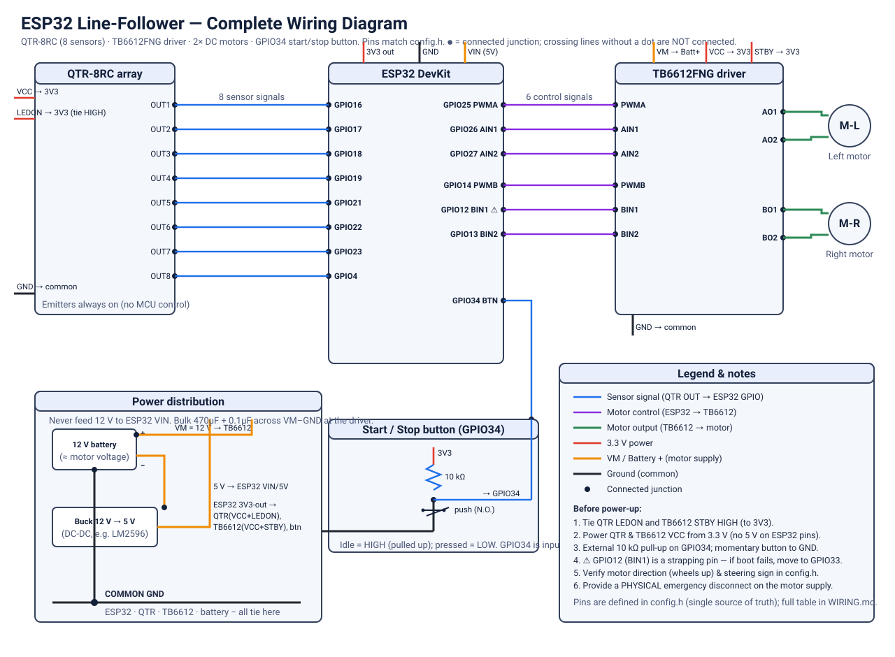
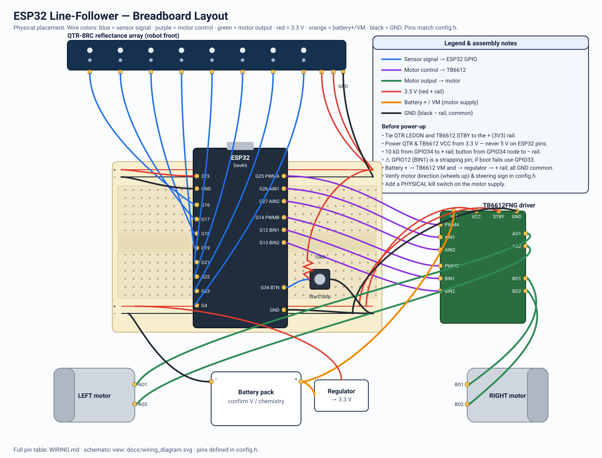
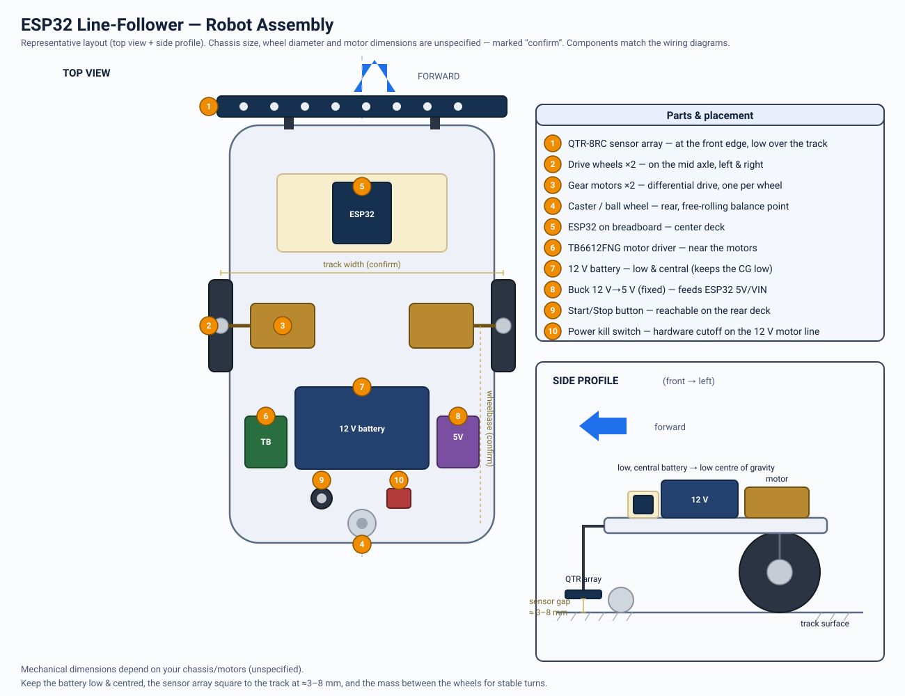

# Wiring & Electrical Guide

Assumed hardware: **ESP32 DevKit (classic)** · **QTR-8RC** 8-channel array ·
**TB6612FNG** dual motor driver. All pins are defined in
[`config.h`](config.h) — this document mirrors those defaults. **If you change a
pin, change it in `config.h`, not only here.**

> ⚠️ **Confirm before a final electrical spec:** battery chemistry/voltage,
> regulator design, motor voltage/current, and that the TB6612 logic supply
> (`VCC`) matches the ESP32's 3.3 V logic. Items below marked **CONFIRM** are
> assumptions.

---

## Diagram

A complete, color-coded schematic is in [`docs/wiring_diagram.svg`](docs/wiring_diagram.svg)
(open in a browser to zoom). It shows every connection in the tables below plus
the power distribution, common ground, and the GPIO34 button circuit.



A **breadboard-style layout** (physical component placement) is in
[`docs/wiring_breadboard.svg`](docs/wiring_breadboard.svg):



A **robot assembly view** (top view + side profile with a numbered parts list)
is in [`docs/robot_layout.svg`](docs/robot_layout.svg). Mechanical dimensions are
representative — confirm chassis size, wheel diameter and motor dimensions for
your hardware. Keep the battery low and central, and the sensor array square to
the track at a constant ≈3–8 mm gap.



## 1. Pin table

### Sensors (QTR-8RC, RC/digital mode)

| Array channel (L→R) | ESP32 GPIO |
|---------------------|-----------|
| Sensor 1            | GPIO16 |
| Sensor 2            | GPIO17 |
| Sensor 3            | GPIO18 |
| Sensor 4            | GPIO19 |
| Sensor 5            | GPIO21 |
| Sensor 6            | GPIO22 |
| Sensor 7            | GPIO23 |
| Sensor 8            | GPIO4  |

- QTR-8RC `VCC` → 3.3 V (the classic QTR-8RC runs at 3.3–5 V; **drive it from
  3.3 V** so its digital lines never exceed the ESP32's 3.3 V limit).
- QTR-8RC `GND` → common ground.
- QTR `LEDON`/`CTRL` → **tie HIGH to 3.3 V** (emitters always on). The firmware
  does not software-control the emitter (`SENSOR_EMITTER_PIN = 0xFF`), which is
  what lets GPIO4 serve as sensor 8. If you later want software emitter control,
  wire LEDON to a spare GPIO and set `SENSOR_EMITTER_PIN` — it must not reuse a
  sensor/motor/button pin.

> **Do not** feed 5 V into any ESP32 GPIO. If you power the QTR board from 5 V,
> its output highs become 5 V and will damage 3.3 V-only ESP32 inputs. Keep the
> QTR logic at 3.3 V.

### Motor driver (TB6612FNG)

| TB6612 pin | Connect to | ESP32 GPIO |
|-----------|------------|-----------|
| PWMA  | Left motor PWM    | GPIO25 |
| AIN1  | Left motor dir 1  | GPIO26 |
| AIN2  | Left motor dir 2  | GPIO27 |
| PWMB  | Right motor PWM   | GPIO14 |
| BIN1  | Right motor dir 1 | GPIO12 ⚠️ strapping pin |
| BIN2  | Right motor dir 2 | GPIO13 |
| STBY  | Enable            | 3.3 V (default) **or** a GPIO if `USE_STBY_PIN` |
| VCC   | Logic supply      | 3.3 V (match ESP32 logic) |
| VM    | **Motor supply**  | Battery motor voltage (**CONFIRM**) |
| GND   | Common ground     | shared with ESP32 & battery − |
| AO1/AO2 | Left motor terminals  | — |
| BO1/BO2 | Right motor terminals | — |

- `STBY` **must be HIGH** for any motion. Default firmware ties it to 3.3 V. To
  control standby in software, set `USE_STBY_PIN = true` and wire `STBY` to
  `MOTOR_STBY_PIN` (default GPIO15).
- ⚠️ **GPIO12 (BIN1) is a strapping pin** (selects flash voltage at reset). It
  matches the existing working wiring and is fine on boards where GPIO12 is low
  at boot, but if the ESP32 ever fails to boot with the driver connected, move
  BIN1 to a non-strapping output (e.g. GPIO33) and update `MOTOR_R_IN1_PIN`.
- For reliable 3.3 V logic levels, power the TB6612 `VCC` from **3.3 V**. `STBY`
  may be tied to 3.3 V (or 5 V) as long as it reads HIGH; keep motor-direction
  input thresholds in mind if you run `VCC` at 5 V.

### Start/Stop button

| Signal | ESP32 GPIO | Notes |
|--------|-----------|-------|
| Button | GPIO34    | **Input-only, NO internal pull-up** |

Required external circuit:

```
3.3V ── 10kΩ ──┬── GPIO34
                │
             [button]
                │
               GND
```

Pressed = LOW (`BUTTON_ACTIVE_LOW = true`). Without the external 10 kΩ pull-up,
GPIO34 floats and the button will read randomly.

## 2. Power architecture

Confirmed pack: **3S LiPo, 11.1 V nominal (12.6 V full charge)**, HongJie 501855,
1400 mAh, 30C, 15.6 Wh. The motor supply and the logic supply split right at the
battery. The motors run on the full pack voltage (11.1 V, up to 12.6 V charged);
the logic runs on 3.3 V, reached via an **11.1 V→5 V buck converter** into the
ESP32's 5V/VIN pin, whose on-board regulator then produces 3.3 V. **Never feed
the raw pack (11–12.6 V) to VIN** — the ESP32's on-board 3.3 V regulator would
overheat.

```
 3S 11.1 V (+)──┬──────────── 11.1 V ────────────► TB6612 VM ──► motors
                │
                └── 11.1 V ──►[ Buck 11.1 V→5 V ]── 5 V ──► ESP32 5V/VIN
                                                              │ (on-board 3.3 V reg)
                                                     ESP32 3V3-out
                                                              │ 3.3 V
                                       ┌──────────────────────┼───────────────┐
                                   QTR-8RC VCC          TB6612 VCC/STBY    GPIO34 pull-up
                                   QTR-8RC LEDON

 3S 11.1 V (−)────────────────── COMMON GND ───► ESP32 · QTR · TB6612 · buck
```

Requirements:
- **Common ground** across ESP32, TB6612, QTR board, buck converter and battery −.
- **Motor supply = VM = 11.1 V** (direct from the pack, 12.6 V fully charged).
  TB6612 `VM` is rated to ~15 V, so this is fine. Motors are rated 6–12 V; at full
  charge (12.6 V) they sit just above 12 V — fine for short race bursts, **but
  confirm your motors tolerate it.**
- **Logic supply via an 11.1 V→5 V buck module** into ESP32 `5V`/`VIN`.
  Size the buck for the ESP32 **plus** everything on the 3.3 V rail (QTR emitters
  can draw ~100 mA) — a 1–2 A module is comfortable. Confirm it reads ~5 V under
  load before connecting the ESP32 (if it's an adjustable module such as an
  MP1584, set the trimpot to 5.0 V first). Do **not** run the ESP32 from the raw
  pack, and do **not** use a linear regulator from 11–12.6 V (it would get very
  hot).
- **3.3 V comes from the ESP32's on-board regulator** (`3V3` pin) and feeds QTR
  VCC + LEDON, TB6612 VCC + STBY and the button pull-up. If the on-board 3.3 V
  regulator can't supply the QTR reliably, add a separate 3.3 V buck/LDO from the
  5 V rail for the sensor board.
- Separate the **motor supply (VM)** from the **logic supply** as above — motors
  inject noise and brownouts reset the ESP32.
- **Decoupling:** place a bulk electrolytic (≥ 470 µF, rated ≥ 16 V for a 12.6 V
  pack) across `VM`/`GND` at the driver, plus a 0.1 µF ceramic close to `VCC`/`GND`.
- The pack (1400 mAh, 30C → ~42 A max) easily covers two small gear motors;
  runtime is modest (15.6 Wh) — fine for laps. **LiPo care:** balance-charge, and
  don't discharge below ~9.9 V (3.3 V/cell). The 3S battery-monitor thresholds are
  pre-set (disabled) in `config.h` if you add a divider later.

## 3. Electrical precautions checklist

- [ ] QTR logic at 3.3 V (no 5 V on ESP32 pins).
- [ ] **11.1 V→5 V buck into ESP32 5V/VIN — never the raw pack to VIN.**
- [ ] Buck output ≈ 5 V under load (set the trimpot if adjustable); sized for ESP32 + QTR emitters.
- [ ] External 10 kΩ pull-up on GPIO34.
- [ ] `STBY` HIGH (or GPIO-controlled) — motors do nothing otherwise.
- [ ] Common ground verified with a meter before applying motor power.
- [ ] Bulk + ceramic decoupling across `VM`/`GND`.
- [ ] Motor supply polarity correct (reverse polarity can destroy the TB6612).
- [ ] TB6612 within its **per-channel current (~1.2 A cont., 3.2 A peak)** and
      thermal limits — if your motors exceed this, choose a larger driver.
- [ ] **Physical emergency disconnect** on the motor supply (inline switch or
      XT60 you can pull). Firmware stop is *not* a safety guarantee.

## 4. Bring-up order (bench)

1. Logic only (USB), no motor power — verify Serial boot banner + calibration.
2. Wheels off the ground, apply motor power — run **Test 4 (motor direction)**
   in [`TEST_PLAN.md`](TEST_PLAN.md).
3. Fix direction via `MOTOR_*_INVERT` in `config.h` (don't rewire).
4. Only then place on the track.
